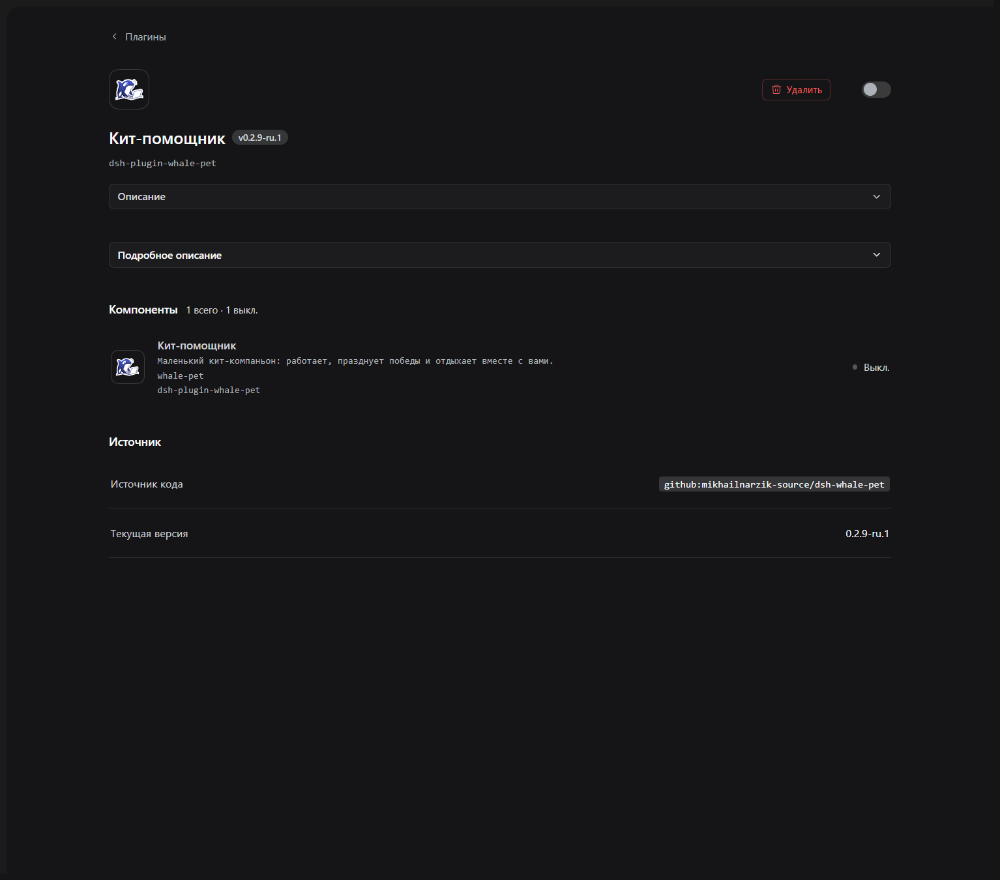

# Кит-помощник (dsh-plugin-whale-pet)

Маленький кит живёт в окне DeepSeek Harness: работает вместе с ассистентом,
радуется завершённым задачам и засыпает, если вы отвлеклись. Это русская
локализация форка плагина [dsh-plugin-whale-pet](https://github.com/Yifffan/dsh-plugin-whale-pet).



*Страница плагина в интерфейсе DSH.*

## Что это и зачем

DSH (DeepSeek Harness) — приложение, в котором вы переписываетесь с ассистентом.
Плагин добавляет поверх окна маленького кита. Он не мешает работе: кит сидит в
углу, показывает, чем занят ассистент, и иногда что-то говорит.

Термины простыми словами:

- **сессия** — один диалог в DSH, он выбран в списке слева;
- **субагент** — помощник, которого агент запускает внутри задачи;
- **состояние кита** — что кит делает сейчас: отдыхает, работает, ждёт, празднует,
  спит или грустит об ошибке;
- **область слежения** — за какой сессией наблюдает кит: только за текущей или за
  всеми на этом компьютере.

Шесть состояний:

| Состояние | Когда бывает | Что видно |
| --- | --- | --- |
| Отдыхает | ассистент ничего не делает | кит спокойно сидит |
| Работает | ассистент выполняет задачу | кит «работает», иногда говорит «Ищу решение…» |
| Ждёт | ассистенту нужно ваше решение: подтверждение, ответ на вопрос | кит смотрит на вас, реплика «Немного помощи?» |
| Празднует | задача успешно завершилась | кит радуется, появляются искры |
| Спит | вы давно ничего не делали | кит вздремнул |
| Ошибка | задача завершилась ошибкой или была отменена | кит грустит |

Зачем это нужно: видеть состояние работы, не вчитываясь в чат, — и получать
немного удовольствия от процесса. Кит работает **внутри окна DSH**, это не
отдельная программа поверх рабочего стола.

## Как открыть

1. Левая панель DSH → **«Плагины»**.
2. Найдите карточку **«Кит-помощник»** (пакет `dsh-plugin-whale-pet`).
3. Проверьте, что компонент плагина **включён** (переключатель в карточке).
   После включения кит появляется в правом нижнем углу окна DSH.
4. **Настройки кита:** щёлкните по киту **правой кнопкой мыши** (или нажмите
   Enter/Space, когда кит в фокусе). Откроется панель настроек.
5. Подробная документация — в той же карточке, раздел **«Подробности»**.

Если плагина в списке нет, установите его (команда в конце этой страницы) и
перезапустите DSH.

## Как пользоваться пошагово

**Включить питомца.**

1. «Плагины» → карточка «Кит-помощник» → включить компонент.
2. Кит появится в правом нижнем углу окна. Если его не видно — нажмите кнопку
   **«Вернуть кита ↗»** (она появляется на месте кита, если он был скрыт).
3. Перезапустите DSH, если интерфейс попросил об этом после установки.

**Управлять китом.**

1. **Клик** по киту — поздоровается и покажет реплику.
2. **Перетащите** кита мышью в удобное место — позиция запоминается.
3. **Правый клик** — открыть настройки.
4. **Стрелки** на клавиатуре двигают кита, **Enter/Space** открывают настройки,
   **Escape** закрывает панель.

**Настроить под себя.** В панели настроек:

- **«Следить»** — «Текущая сессия» (только за выбранным диалогом) или «Все
  сессии» (за всеми обычными диалогами на этом компьютере);
- **«Размер»** — ползунок от 65% до 160%;
- **«Плавные анимации»** — включить или выключить плавность;
- **«Вздремнуть после»** — через сколько бездействия кит засыпает (30 секунд,
  2 минуты или 5 минут);
- **«Сбросить позицию»** — вернуть кита в угол;
- **«Убрать кита»** — спрятать; вернуть можно кнопкой «Вернуть кита ↗»;
- **«Закрыть настройки»** (✕) — просто закрыть панель, кит останется.

**Выключить питомца совсем.**

1. «Плагины» → карточка «Кит-помощник» → выключить компонент. Кит исчезнет.
2. Включить обратно — там же.
3. Удалить плагин полностью — кнопкой удаления в карточке.

Настройки кита хранятся в браузере на этом компьютере: на другом устройстве они
не появятся.

## Примеры

**Кит работает.** Попросите ассистента сделать что-то на несколько шагов:
«Проверь папку проекта и покажи список файлов». Пока ход выполняется, кит
переключается в состояние «Работает» и комментирует: «Кит взялся за дело!»,
«Дай подумать…», «Небольшой прогресс!».

**Кит ждёт.** Попросите действие, которое требует подтверждения: «Создай файл и
покажи его мне». Когда ассистент попросит разрешение, кит покажет «Немного
помощи?» — это значит, что DSH ждёт вашего решения.

**Кит празднует.** После успешного завершения задачи кит радуется: «Только что
закончил задачу!», «Ещё одна готова. Ура!». Праздник включается только при
нормальном завершении хода: отмена и ошибка — это состояние «Ошибка», а не
успех.

**Кит спит.** Если вы настроили «Вздремнуть после» и отошли, через выбранное
время кит засыпает: «Немного вздремну…». Вернулись и начали новую задачу — кит
просыпается.

**Несколько сессий.** В режиме «Все сессии», когда работают несколько обычных
диалогов, на ките появляется счётчик работающих сессий. Субагенты отдельными
сессиями не считаются.

**Скрыть и вернуть.** Правый клик → **«Убрать кита»**. Кит исчезнет, а на его
месте появится кнопка **«Вернуть кита ↗»** — нажмите её, чтобы вернуть питомца.

## Что вы увидите

**Кит в окне.** Маленький рисунок кита в правом нижнем углу по умолчанию. При
наведении и клике появляется облачко с репликой. В состоянии «Празднует» вокруг
кита вспыхивают искры. Если работать в нескольких сессиях, на ките может быть
счётчик работающих.

**Панель настроек.** Заголовок «Ваш маленький кит-помощник», подпись «Без спешки,
просто немного компании.», селектор «Следить», ползунок «Размер» с процентом,
переключатель «Плавные анимации», селектор «Вздремнуть после», кнопки «Сбросить
позицию» и «Убрать кита», крестик закрытия.

**Кнопка возврата.** «Вернуть кита ↗» на месте скрытого кита.

**Карточка в «Плагинах».** Иконка с китом, название «Кит-помощник», описание,
версия, переключатель компонента и раздел «Подробности».

**Страница в «Плагинах».** Центрированная колонка до 960 px: в шапке иконка 🐳,
название, чип «На экране»/«Скрыт» и кнопка **«Обновить»**. Ниже карточки
«Питомец» и «Настройки» с теми же органами управления, что и в панели кита:
показ питомца, «Следить», «Размер», «Плавные анимации», «Вздремнуть после» и
«Сбросить позицию». Изменения сразу видны на ките в окне. На узком экране
(до 760 px) отступы меньше, а карточки встают в одну колонку.

**Кнопки и адаптив.** Кнопки страницы — одной системы: высота 36 px (в шапке 32),
padding 0 14 px, радиус 10 px, ширина по тексту. «Обновить» и «Сбросить позицию»
— secondary с рамкой; основная кнопка (primary) — мягкая заливка brand 18 % с
brand-рамкой и brand-текстом, без белой заливки с белым текстом. Карточки —
auto-fit сетка с минимумом 280 px, в ряду одной высоты, футер прижат к низу.
Медиазапросы 900 и 640 px: одна колонка и меньшие отступы; проверено на 1280,
1024, 768 и 480 px — ничего не выходит за край. Сам кит и его панель не менялись:
настройки и обработчики прежние.

**Реплики.** В русской локализации переведены основные подписи и реплики. Часть
мелких служебных надписей (например, варианты времени сна и счётчик сессий)
может остаться на английском — это особенность форка.

## Частые ошибки и что делать

| Симптом | Причина | Что сделать |
| --- | --- | --- |
| Кита нет совсем | компонент плагина выключен или плагин не установлен | «Плагины» → «Кит-помощник» → включить компонент; после установки перезапустить DSH |
| Кит исчез после перезапуска | вы нажали «Убрать кита» — настройка сохранилась | нажать «Вернуть кита ↗» на месте кита |
| Кит не реагирует на завершение задачи | «Следить» стоит «Текущая сессия», а задача шла в другой | переключить на «Все сессии» |
| Кит не радуется завершению | задача была отменена или завершилась ошибкой | это правильное поведение: успех только при нормальном завершении |
| Кит не видит работу субагентов | субагенты не считаются отдельными главными сессиями | так задумано; смотрите состояние основной задачи |
| Кит перекрывает важную кнопку | он стоит поверх интерфейса | перетащите его, уменьшите размер или нажмите «Убрать кита» |
| Панель настроек не открывается | щелчок был не правой кнопкой | правый клик по киту или Enter/Space, когда кит в фокусе |
| Кит появился, но подписи частично на английском | русская локализация переведена не полностью | это известное ограничение форка |
| После обновления поведение старое | новый код подхватывается при перезапуске | полностью закрыть и открыть DSH |
| Обновились с версии 0.2.6 или раньше | изменился идентификатор записи плагина | прочитать `UPGRADE.md`; старые настройки могли не перенестись |

## Ограничения и безопасность

- Кит живёт **внутри окна DSH** (слой поверх интерфейса). Это не отдельная
  программа, не виджет рабочего стола и не уведомление Windows. Пока DSH закрыт,
  кита нет.
- Плагин **не отправляет сообщения модели**, не делает запросов к ней, не
  обрабатывает подтверждения за вас и не влияет на работу ассистента. Он только
  отображает состояние.
- Плагин читает минимальные данные: идентификатор сессии и границы хода
  (начало/конец). Текст переписки, содержимое файлов и вложения не читаются и
  никуда не отправляются.
- Плагин использует уже существующее соединение DSH. Он не открывает новый
  сетевой порт, не отправляет телеметрию и не скачивает шрифты из интернета (они
  внутри пакета).
- Состояние и настройки хранятся в браузере на этом компьютере (в localStorage).
  «Все сессии» — это только обычные главные диалоги на текущем подключённом
  DSH, а не несколько компьютеров.
- Субагенты не считаются отдельными сессиями. Завершение засчитывается только по
  нормальному окончанию хода; отмена, ошибка, история и снижение счётчика сами по
  себе праздник не вызывают.
- Это личный проект, а не официальный продукт DeepSeek. Код под лицензией MIT.
  Рисунки китов — оригинальная работа DeepSeek с отдельными условиями
  (`ASSETS-LICENSE.md`), шрифты — по лицензиям SIL OFL (`FONT-LICENSES.md`).
  Лицензия на код не даёт права свободно переиспользовать рисунки.
- Изначально плагин сделан для DSH Desktop 0.1.6-alpha.2 на macOS arm64. На
  других версиях и системах он работает не гарантированно; проверяйте на своём
  окружении.

## Связанные плагины

- **dsh-notify** — плашки и звук о завершении задачи или запросе подтверждения,
  когда окно DSH свёрнуто. Кит показывает состояние в окне, уведомления —
  снаружи; вместе удобно.
- **dsh-team** — помогает собрать задание для нескольких субагентов. Кит считает
  только обычные главные сессии, активность субагентов отдельно не показывает.
- **dsh-polish** — единое оформление кнопок и полей у плагинов; кит использует
  цветовые токены темы DSH, поэтому выглядит уместно в светлой и тёмной теме.
- **dsh-compact** — локальное сжатие длинного диалога; кит просто продолжает
  жить рядом.

## Установка

Русская локализация — отдельный форк. Установка из репозитория форка:

```powershell
dsh plugin --profile desktop add github:mikhailnarzik-source/dsh-whale-pet
```

Или в интерфейсе: **«Плагины» → «Добавить плагин»** → вставить
`github:mikhailnarzik-source/dsh-whale-pet`. После установки перезапустите DSH,
затем включите компонент в карточке.

Оригинал (без русского перевода) ставится как `dsh-plugin-whale-pet` с npm или
из репозитория `github:Yifffan/dsh-plugin-whale-pet`. Имя пакета у форка
оставлено прежним, чтобы он вставал на место оригинала без правок профиля.

Сборка не требуется: файлы плагина уже собраны и лежат в пакете.
