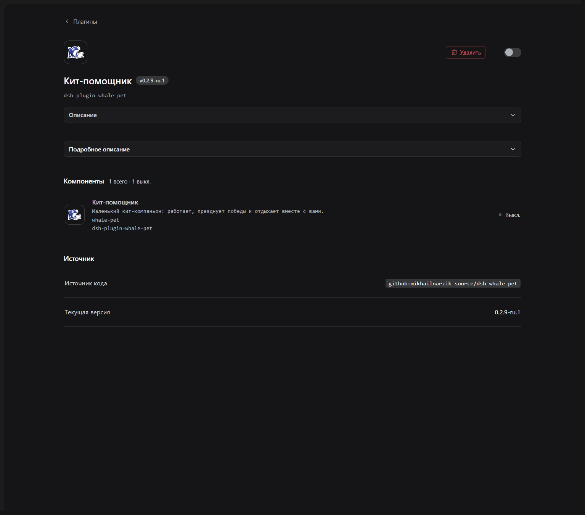

# Кит-помощник — подробное описание

Плагин `dsh-plugin-whale-pet` (русская локализация) добавляет в окно DeepSeek
Harness маленького кита. Кит показывает, чем занят ассистент, и живёт в слое
поверх интерфейса. Этот файл — подробное руководство; краткая версия — в
`README.md` плагина.

## Что это и зачем

DSH — приложение для общения с ассистентом. Задачи идут минутами: ассистент
думает, вызывает инструменты, иногда ждёт вашего подтверждения. Кит делает это
состояние видимым: он работает, ждёт, празднует, грустит об ошибке или спит.

Что важно понимать:

- это **окно-компаньон**, а не отдельная программа: кит рисуется внутри окна
  DSH, поверх интерфейса, и пропадает, когда DSH закрыт;
- кит **не влияет на работу** ассистента: не отправляет сообщения модели, не
  отвечает за вас на подтверждения, не меняет ход задачи;
- кит **не читает переписку**: он получает только факты «ход начался / ход
  закончился», идентификатор сессии и причину окончания.

Термины:

- **сессия** — один диалог в DSH (список слева);
- **субагент** — помощник, которого агент запускает внутри задачи; у него своя
  служебная сессия, но отдельной «главной» она не считается;
- **ход** — один цикл работы ассистента от вашего сообщения до ответа;
- **область слежения** — «Текущая сессия» или «Все сессии»;
- **localStorage** — хранилище браузера на этом компьютере.

## Как открыть

1. Левая панель DSH → **«Плагины»**.
2. Карточка **«Кит-помощник»** (пакет `dsh-plugin-whale-pet`).
3. Убедитесь, что компонент плагина включён. Кит появится в окне сразу после
   включения; после установки плагина нужен перезапуск DSH.
4. Настройки: **правый клик** по киту (или Enter/Space, когда кит в фокусе).
5. Раздел **«Подробности»** в карточке открывает этот документ.

Если кит был скрыт, на его месте показывается кнопка **«Вернуть кита ↗»**.

## Как пользоваться пошагово

1. **Включите компонент** в карточке. Кит появится в правом нижнем углу.
2. **Поздоровайтесь:** клик по киту показывает реплику.
3. **Перетащите** кита в удобное место. Позиция сохраняется; после перезапуска
   кит вернётся туда же (если помещается в окно — позиция ограничивается краями).
4. **Откройте настройки** правым кликом. Внутри:
   - **«Следить»**: «Текущая сессия» или «Все сессии»;
   - **«Размер»**: ползунок 65–160%;
   - **«Плавные анимации»**: включить/выключить;
   - **«Вздремнуть после»**: 30 секунд, 2 минуты или 5 минут;
   - **«Сбросить позицию»**, **«Убрать кита»**, крестик закрытия.
5. **Спрячьте кита:** «Убрать кита». На его месте появится кнопка возврата.
6. **Верните:** «Вернуть кита ↗».
7. **Выключите совсем:** «Плагины» → карточка «Кит-помощник» → переключатель
   компонента. Включение — там же.
8. **Клавиатура:** стрелки двигают кита, Enter/Space открывают настройки,
   Escape закрывает панель, клик мимо панели тоже её закрывает.

Настройки применяются сразу и сохраняются в браузере этого компьютера.

## Примеры

**Что вызывает каждое состояние.**

| Состояние | Триггер | Реплики (примеры) |
| --- | --- | --- |
| Отдыхает | ассистент свободен | «Немного отдыха. Готов, когда вы готовы.» |
| Работает | начался ход ассистента | «Кит взялся за дело!», «Ищу решение…», «Дай подумать…» |
| Ждёт | ассистенту нужно ваше решение (подтверждение, вопрос, проверка) | «Немного помощи?» |
| Празднует | ход завершился нормально | «Только что закончил задачу!», «Задача выполнена. Отлично!» |
| Спит | бездействие дольше выбранного времени | «Немного вздремну…» |
| Ошибка | ход завершился ошибкой или отменён | «В задаче возникла проблема.» |

**Приоритет состояний.** «Ждёт» показывается раньше «работает», потому что
решение нужно человеку. Ошибка и ожидание не перебиваются короткими
уведомлениями о завершении. Праздник включается только для нормального
завершения: отмена и ошибка — это «Ошибка», а не успех.

**Счётчик работающих сессий.** В режиме «Все сессии» на ките появляется число
работающих обычных сессий (на английском: `1 session working`,
`N sessions working`). Субагенты в счётчик не входят: их активность относится к
основной задаче.

**Сон.** Настройка по умолчанию — 2 минуты. Значение действует на бездействие:
если задачи не идут и вы не трогаете интерфейс, кит засыпает; новое событие
будит его.

**Скрытие.** «Убрать кита» сохраняется между перезапусками: кит не появится сам,
пока вы не нажмёте «Вернуть кита ↗» или не сбросите настройки браузера.

## Что вы увидите

**Кит.** Рисунок в правом нижнем углу по умолчанию, с «землёй» под ним. В
зависимости от состояния картинка меняется; в празднике вокруг вспыхивают искры.
Над китом появляется облачко с репликой. Если кита перетащить, он останется на
новом месте.

**Панель настроек.** Заголовок «Ваш маленький кит-помощник», подпись «Без спешки,
просто немного компании.», селектор «Следить», ползунок «Размер» (65–160%),
переключатель «Плавные анимации», селектор «Вздремнуть после», кнопки «Сбросить
позицию» и «Убрать кита», крестик. Панель появляется рядом с китом и не уходит за
край окна.

**Кнопка возврата.** «Вернуть кита ↗» — на месте скрытого кита.

**Карточка в «Плагинах».** Иконка с китом, название «Кит-помощник», описание,
версия, переключатель компонента, раздел «Подробности».

**Локализация.** Русская версия переводит основные подписи и реплики. Некоторые
мелкие служебные строки (варианты времени сна, счётчик сессий, подсказка для
скринридера) остаются на английском — это особенность форка.

## Как это выглядит

*Рисунок 1. Страница плагина: описание, настройки и кнопки.*

*Рисунок 2. Рабочий раздел плагина: органы управления и результат.*

С этого выпуска у плагина есть страница в «Плагинах», оформленная в едином стиле:
центрированная колонка шириной до 960 px, в шапке иконка 🐳, название
«Кит-помощник», подпись, чип «На экране»/«Скрыт» и кнопка **«Обновить»**. Ниже —
карточки «Питомец» (переключатель показа и «Сбросить позицию») и «Настройки»
(«Следить», «Размер», «Плавные анимации», «Вздремнуть после») с акцентной
полоской у заголовка. Настройки общие с панелью кита: изменение на странице
сразу применяется к киту в окне. На узком экране (до 760 px) карточки встают в
одну колонку, отступы уменьшаются.

## Частые ошибки и что делать

| Симптом | Причина | Что сделать |
| --- | --- | --- |
| Кита нет | компонент выключен | «Плагины» → «Кит-помощник» → включить компонент |
| Кита нет после установки | клиентский модуль загружается при старте | перезапустить DSH |
| Кит не появился после включения | он был скрыт ранее | нажать «Вернуть кита ↗» или очистить настройки браузера |
| Кит застрял за краем окна | позиция сохранена для большего окна | «Сбросить позицию» в настройках |
| Кит не реагирует | «Текущая сессия», а задача в другой сессии | переключить «Следить» на «Все сессии» |
| Нет праздника после задачи | задача отменена или завершилась ошибкой | это правильно; успех только при нормальном завершении |
| Счётчик не учитывает помощников | субагенты не считаются главными сессиями | так задумано |
| Панель не открывается | нажали левой кнопкой | правый клик по киту; с клавиатуры — Enter/Space |
| Часть надписей на английском | локализация форка неполная | известное ограничение |
| После обновления всё по-старому | новый код подхватывается при перезапуске | полностью закрыть и открыть DSH |
| Обновление с 0.2.6 или раньше | изменился идентификатор записи (`whale-pet`) | прочитать `UPGRADE.md`; старые overrides не переносятся автоматически |

## Ограничения и безопасность

- Кит **не является** отдельным окном операционной системы, виджетом рабочего
  стола или системным уведомлением. Он рисуется внутри окна DSH.
- Плагин **не делает запросов к модели**, не обрабатывает подтверждения, не
  действует за вас. Он только отображает состояние.
- Читаются минимальные данные: идентификатор сессии, признак субагента, границы
  хода (`turn/start`, `turn/end`) и причина окончания. Текст сообщений, файлы,
  вложения и история переписки не читаются.
- Плагин использует существующее соединение DSH. Он не открывает новый порт, не
  отправляет телеметрию, не скачивает шрифты или картинки из сети — всё внутри
  пакета. Файлы сессий не сохраняются.
- Настройки хранятся в браузере (localStorage, ключ `dsh-plugin-whale-pet:v1`).
  На другом компьютере или в другом браузере их не будет. «Все сессии» — только
  обычные главные сессии на текущем подключённом DSH, не несколько устройств.
- Завершение засчитывается только по нормальному окончанию хода. Отмена, ошибка,
  восстановленная история, переподключение и снижение счётчика сами по себе
  успехом не считаются. Короткие уведомления не проигрываются заново после
  переподключения.
- Это личный проект, не официальный продукт DeepSeek. Код — MIT; рисунки китов
  принадлежат DeepSeek и имеют отдельные условия использования
  (`ASSETS-LICENSE.md`); шрифты — SIL OFL (`FONT-LICENSES.md`). Лицензия на код
  не даёт права свободно извлекать и распространять рисунки.
- Оригинальный плагин разрабатывался для DSH Desktop 0.1.6-alpha.2 на macOS
  arm64. На других версиях DSH и других системах поведение не гарантировано;
  часть возможностей (нативные селекторы, `corner-shape`) зависит от браузера.
- Имя пакета оставлено `dsh-plugin-whale-pet`, чтобы клиент загружался и форк
  вставал на место оригинала. Идентификатор записи в профиле — `whale-pet`.
- Сборка не требуется: файлы клиента и Host уже собраны. Для разработки нужны
  Node.js 22+ и pnpm; команды сборки и тестов есть в исходном репозитории.

## Связанные плагины

- **dsh-notify** — уведомления о завершении задачи и о запросе подтверждения
  плашками и звуком, в том числе когда окно свёрнуто. Кит показывает состояние
  внутри окна; вместе они закрывают разные сценарии.
- **dsh-team** — панель для сборки задания нескольким субагентам. Кит видит
  основную сессию, а не каждого помощника отдельно.
- **dsh-polish** — общий слой оформления плагинов; кит рисуется токенами темы
  DSH, поэтому корректно выглядит в светлой и тёмной теме.
- **dsh-compact** — сжатие длинного диалога в короткую выжимку; на кита не
  влияет, просто продолжает жить рядом.
